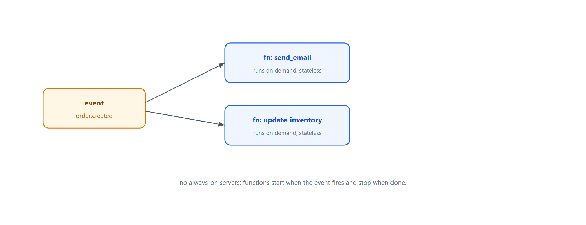
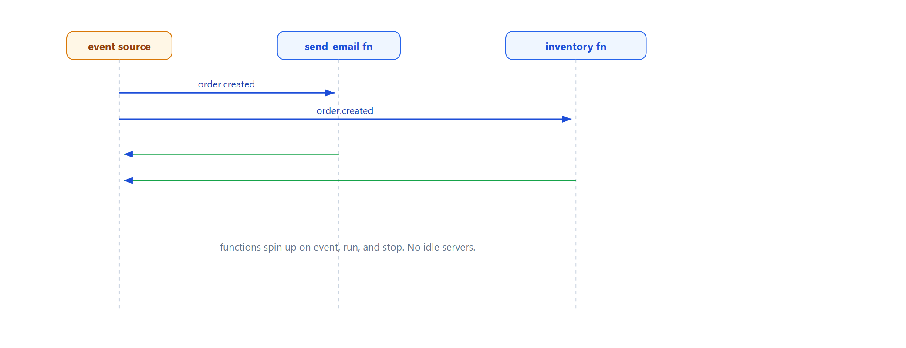

# Learn Serverless — Event-Triggered Stateless Functions

> **Learning / study repo. Self-contained demo, NOT production code.**
> Functions run on demand when an event fires. No servers to manage, no always-on processes.
> Each function is stateless and triggered by an event.

## The idea

```
  event: order.created
        │
        ├─► function: send_email      (runs on demand)
        └─► function: update_inventory (runs on demand)

  event: payment.received
        │
        └─► function: confirm_order   (runs on demand)
```

- Functions are stateless and short-lived.
- They start when an event arrives and stop when done.
- No idle servers, no capacity planning — pay per invocation.



## Why this matters

- **No server ops** — you only write functions, not infra.
- **Auto-scaling** — each event can spin up a new instance.
- **Pay-per-use** — no cost when idle.

## Run

```bash
python run_all.py
```

Pure Python standard library.

## Demo cases

1. **order.created** triggers email + inventory functions.
2. **payment.received** triggers the confirm function.

## Flow



## Sibling repos

- `learn_event_fanout` — the event fan-out that serverless functions subscribe to.
- `learn_pipeline_filters` — functions can chain into pipelines.
- `learn_bff_gateway` — the frontend entry point.
